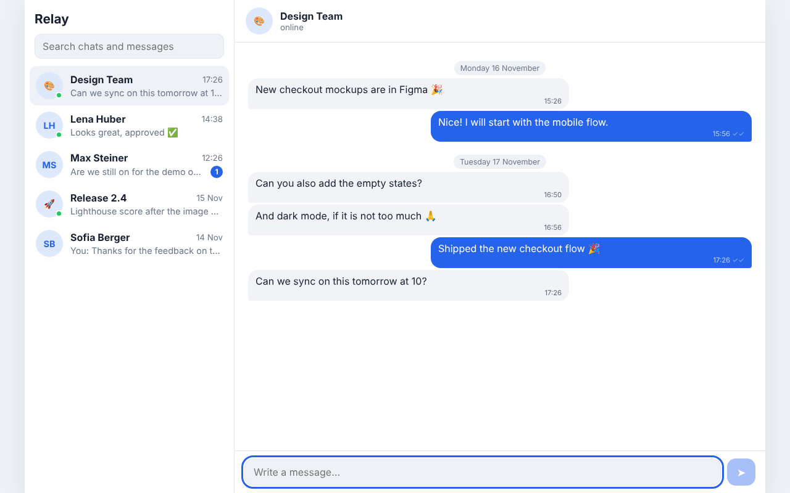
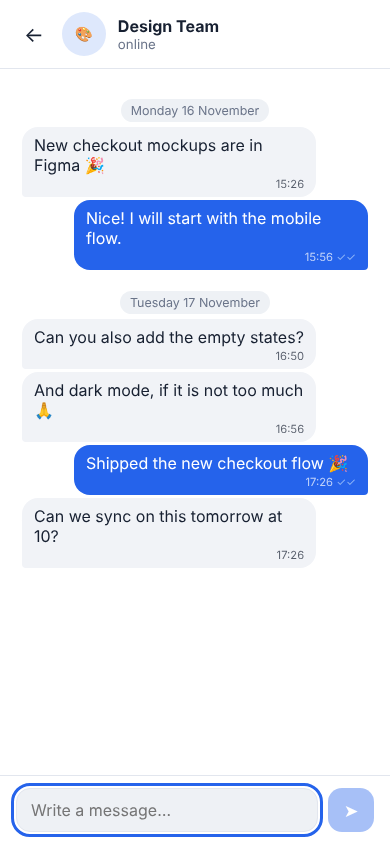

# Relay – React chat interface

A messenger-style chat UI with the details users expect from a real product: conversation list with unread counters and search, optimistic sending with delivery ticks, typing indicator, day separators, auto-scroll, keyboard shortcuts, dark mode and a mobile layout.

**[▶ Live demo](https://anton-simeon.github.io/relay-chat/)** – replies are simulated in the browser.

| Desktop | Mobile – chats | Mobile – thread |
|---|---|---|
|  |  |  |

## Features

- **Conversation list** sorted by latest activity, online dots, unread badges, search across names *and* message text
- **Optimistic sending:** message appears instantly (🕓 → ✓ sent → ✓✓ read when the other side answers)
- **Typing indicator**, incoming messages in other chats increase their unread counter
- **Thread:** day separators, auto-scroll to the newest message, `role="log"` + `aria-live` for screen readers
- **Composer:** Enter to send, Shift + Enter for a new line, send button disabled for empty input
- **Persistence** in `localStorage`, dark mode via `prefers-color-scheme`, responsive list / thread navigation on phones

## Tech

React 18 (`useReducer`) · TypeScript (strict) · Vite · Vitest · plain CSS · GitHub Actions → GitHub Pages

The whole chat state machine is a pure reducer in [`src/chat.ts`](src/chat.ts) (open, send, status updates, typing, receive) plus selectors for sorting, search and day grouping – all covered by [`src/chat.test.ts`](src/chat.test.ts). Swapping the simulated replies for a WebSocket would only touch `App.tsx`.

## Run locally

```bash
npm install
npm run dev
npm test
```

---

Built by [Volodymyr Anton-Simeon](https://github.com/Anton-Simeon) – Senior Frontend Engineer (React · Next.js · TypeScript).
